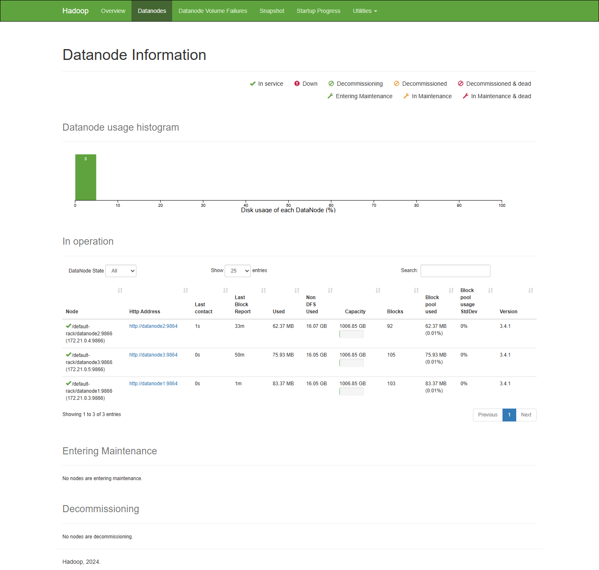
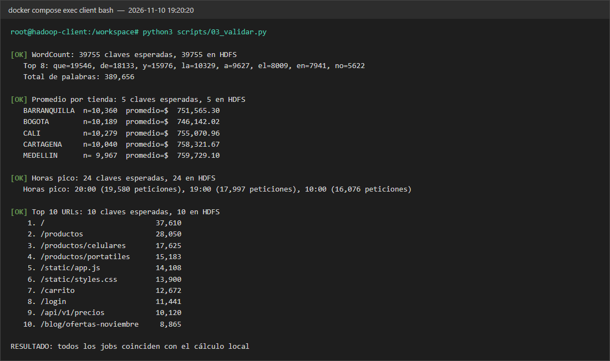
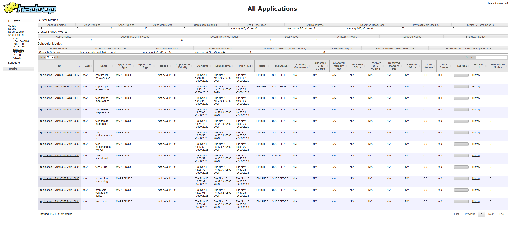
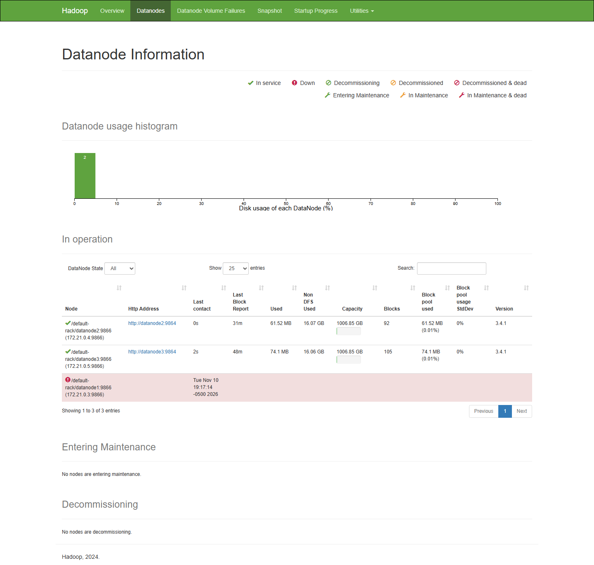

# Taller: HDFS y Hadoop MapReduce con Docker

Cloud Computing — Universidad Autónoma de Occidente. Profesor: Heberth Martinez.

**Integrantes:** _Jose Emanuel Morcillo - Jose David Buitrago Aponte_

Montamos un clúster Hadoop con Docker Compose, corrimos 5 jobs MapReduce y probamos qué pasa cuando fallan los nodos. Partimos del laboratorio de ejemplo [CloudComputingUAO/HDFS](https://github.com/CloudComputingUAO/HDFS), que solo tenía HDFS, y le agregamos YARN para poder ejecutar MapReduce.

## 1. El clúster

| Servicio | Para qué sirve | Interfaz web |
| --- | --- | --- |
| `namenode` | Guarda los metadatos de HDFS: qué archivos hay y dónde está cada bloque | http://localhost:9870 |
| `datanode1`, `datanode2`, `datanode3` | Guardan los bloques de los archivos | — |
| `resourcemanager` | Reparte memoria y CPU entre los jobs (YARN) | http://localhost:8088 |
| `nodemanager1`, `nodemanager2` | Ejecutan las tareas map y reduce | http://localhost:8042, http://localhost:8043 |
| `historyserver` | Guarda el historial de los jobs terminados | http://localhost:19888 |
| `client` | Terminal desde donde lanzamos los comandos y los jobs | — |

Configuración principal (carpeta [`config/`](config/)):

- **Replicación 2** con 3 DataNodes: si cae un nodo, HDFS puede copiar los bloques perdidos al nodo que queda libre.
- **Bloques de 1 MiB**: así archivos de pocos MB se dividen en varios bloques y generan varios maps.
- **Detección rápida de fallos**: un DataNode se declara muerto a los ~90 s y un NodeManager a los ~30 s (por defecto son unos 10 minutos).



## 2. Cómo ejecutarlo

Se necesita Docker Desktop. En Windows, los comandos `bash` se corren en Git Bash.

```bash
bash scripts/00_preparar_datasets.sh
docker compose up -d --build
docker compose ps
```

Todo lo de Hadoop se corre dentro del contenedor cliente. En Windows, este comando funciona mejor en PowerShell:

```bash
docker compose exec client bash
```

Ya dentro del contenedor:

```bash
bash scripts/01_cargar_datos.sh      # sube los datasets a HDFS
bash scripts/02_ejecutar_jobs.sh     # corre los 4 jobs
bash scripts/02_ejecutar_jobs.sh falla   # corre el job que falla a propósito
python3 scripts/03_validar.py        # compara los resultados con un cálculo sin Hadoop
bash scripts/04_verificar.sh         # estados en YARN, logs y salidas en HDFS
```

Los experimentos de fallos se corren desde la terminal normal (fuera del contenedor), porque apagan y prenden contenedores:

```bash
bash scripts/fallas/01_apagar_datanode.sh
bash scripts/fallas/02_reiniciar_datanode_escritura.sh
bash scripts/fallas/03_matar_nodemanager.sh
bash scripts/fallas/03_matar_nodemanager.sh am
bash scripts/fallas/04_matar_tareas_map_reduce.sh
```

Para apagar todo y borrar los datos: `docker compose down -v`.

## 3. Jobs MapReduce

Usamos tres datasets, organizados en HDFS por carpeta:

| Dataset | Carpeta en HDFS | Tamaño | Bloques |
| --- | --- | --- | --- |
| *Don Quijote* (Proyecto Gutenberg) | `/taller/input/libros` | 2,1 MB | 3 |
| Transacciones del repositorio de ejemplo | `/taller/input/transacciones` | 4,6 MB | 5 |
| Log de un sitio web (lo generamos con [`generate_access_log.py`](scripts/generate_access_log.py)) | `/taller/input/logs` | 23,7 MB | 24 |

Cada job escribe su resultado en `/taller/output/<nombre del job>`. El código está en [`jobs/`](jobs/).

| Job | Cómo lo hicimos | Resultado | Estado |
| --- | --- | --- | --- |
| WordCount | Java, con el ejemplo que trae Hadoop | 389.656 palabras; la más usada es "que" (19.546) | SUCCEEDED |
| Promedio de ventas por tienda | Python (Hadoop Streaming) con combiner | Promedio entre $746.142 (Bogotá) y $759.729 (Medellín) | SUCCEEDED |
| Horas pico del log | Python (Hadoop Streaming) | Las horas con más visitas son 20:00, 19:00 y 10:00 | SUCCEEDED |
| Top 10 URLs | Python (Hadoop Streaming) con un solo reducer | La más visitada es `/`, con 37.610 visitas | SUCCEEDED |
| Falla intencional | El mapper lanza un error a propósito | Se reintenta 4 veces por tarea y el job falla | FAILED |

Cada job lanzó un map por bloque: 3, 5, 24 y 24 maps.

**Validación:** el script [`03_validar.py`](scripts/03_validar.py) vuelve a calcular todo con Python, sin Hadoop, y lo compara con lo que quedó en HDFS. Los 4 jobs coinciden.



## 4. Verificación

- En YARN (http://localhost:8088) los 4 jobs aparecen como **SUCCEEDED** y el de falla como **FAILED**.
- Mientras corre un job se ve en **RUNNING**, con sus maps repartidos en los dos NodeManagers.
- En los logs del job fallido (`yarn logs -applicationId <id>`) aparece el error del mapper: `RuntimeError: Falla intencional del taller`.
- En HDFS (`hdfs dfs -ls` y `hdfs dfs -cat`), cada job exitoso deja su resultado y un archivo `_SUCCESS`; el job fallido deja su carpeta vacía.



## 5. Tolerancia a fallos

| Fallo | Qué hicimos | Qué pasó |
| --- | --- | --- |
| Apagar un DataNode | `docker compose stop datanode1` | A los 89 s el NameNode lo marcó como muerto. 20 bloques quedaron con una sola copia, pero el archivo se seguía leyendo. HDFS volvió a copiarlos solo y el checksum no cambió. |
| Reiniciar un DataNode mientras se escribe | Reiniciamos `datanode2` subiendo un archivo de 60 MB | El cliente dejó de usar ese nodo y siguió con los otros. El archivo quedó igual al original (mismo MD5). |
| Apagar un NodeManager con un job corriendo | `docker compose kill nodemanager1` | A los 33 s YARN lo marcó como LOST. Sus 8 maps se volvieron a correr en el otro nodo y el job terminó bien. |
| Apagar el nodo del ApplicationMaster | Matamos el NodeManager que coordinaba el job | YARN lanzó un segundo ApplicationMaster en el otro nodo y el job terminó bien. |
| Matar tareas map y reduce | `pkill` de los procesos de las tareas | Las tareas quedaron FAILED, se reintentaron y el job terminó bien. |

En los experimentos con jobs, el resultado fue igual al del job sin fallos.



**Conclusiones:**

- HDFS aguanta la caída de un nodo porque cada bloque tiene copias en nodos distintos, y repone las copias solo.
- MapReduce aguanta fallos porque, si una tarea se cae, la vuelve a correr en otro nodo.
- Los reintentos no arreglan errores del código: por eso el job de falla termina en FAILED.
- Hay un solo NameNode y un solo ResourceManager. Si se cae alguno de los dos, se cae el clúster.

## 6. Evidencias

En [`evidencias/`](evidencias/) está la salida de cada paso y de cada experimento. En [`evidencias/capturas/`](evidencias/capturas/) hay 44 capturas:

| Capturas | Qué muestran |
| --- | --- |
| `01`–`06` | HDFS: DataNodes, carpetas y bloques |
| `10`–`16` | YARN: aplicaciones, nodos y estados |
| `20`–`30` | JobHistory: detalle de cada job e intentos fallidos |
| `40`–`49` | Un job en RUNNING y un DataNode cayéndose y recuperándose |
| `60`–`67` | Salida de los comandos `hdfs` y `yarn` (generada como imagen) |

## Estructura

```
├── compose.yaml        # los 9 contenedores
├── Dockerfile          # Hadoop 3.4.1 + Python
├── config/             # configuración de HDFS, YARN y MapReduce
├── datasets/           # datos de entrada
├── jobs/               # mappers y reducers en Python
├── scripts/            # carga de datos, jobs, validación y experimentos de fallos
└── evidencias/         # resultados y capturas
```
